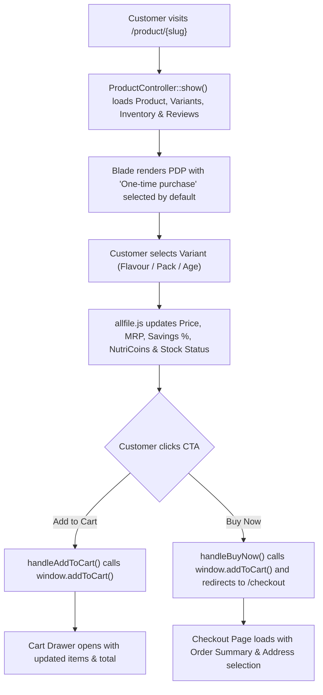
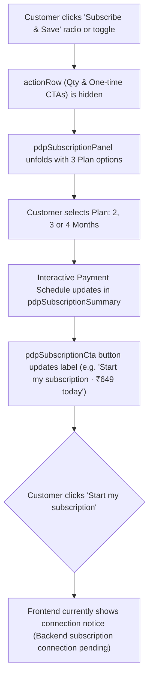

# Product Details Page (PDP): One-Time Purchase & Subscribe & Save Flows

This document details the complete functional architecture, UI state machines, and end-to-end data flows for both **One-Time (Individual) Purchase** and **Subscribe & Save** on the NutriBuddy storefront.

---

## 1. Architectural File Map

| Layer | File / Location | Responsibility |
| :--- | :--- | :--- |
| **Route** | [routes/storefront.php](file:///e:/website-project/Nutribuddy/routes/storefront.php) | `Route::get('/product/{slug}', [ProductController::class, 'show'])->name('product.show')` |
| **Controller** | [ProductController.php](file:///e:/website-project/Nutribuddy/app/Http/Controllers/Frontend/Storefront/ProductController.php) | Eager-loads relations (`variants.inventory`, `taxRate`, `images`, `ingredients`, `reviews`), resolves review permissions, fetches related products. |
| **View Wrapper** | [resources/views/pages/product.blade.php](file:///e:/website-project/Nutribuddy/resources/views/pages/product.blade.php) | Entry-point include wrapper passing `$product`, `$relatedProducts`, `$reviewState`. |
| **Core Template** | [resources/views/frontend/storefront/products/show.blade.php](file:///e:/website-project/Nutribuddy/resources/views/frontend/storefront/products/show.blade.php) | Primary markup for hero, gallery, purchase options fieldset, subscription panel, ingredient modals, and sticky bar. |
| **Client Script** | [public/assets/js/pages/allfile.js](file:///e:/website-project/Nutribuddy/public/assets/js/pages/allfile.js) | Handles image zoom, thumbnail carousel, variant selection resolution, pricing calculations, cart drawers, and sticky bar triggers. |
| **Stylesheet** | [public/assets/css/product.css](file:///e:/website-project/Nutribuddy/public/assets/css/product.css) | Responsive styling for purchase fieldsets, subscription cards, breakdown summary table, and mobile sticky bar. |

---

## 2. Flow 1: Individual (One-Time) Purchase

In this standard eCommerce flow, the customer selects specific product attributes (flavour, pack size, age group), chooses a quantity, and purchases a single shipment.

### Architecture Diagram



### Step-by-Step Execution Sequence

1. **Default State on Page Load:**
   * `<input type="radio" name="pdpPurchaseOption" value="once" checked>` is active.
   * Container `.pdp-action-row` is visible, exposing:
     * Quantity Selector (`#pdpQtyVal` with decrement `−` and increment `+`).
     * Primary Buttons: **Add to Cart** (`#pdpAddToCartBtn`) and **Buy Now** (`#pdpBuyNowBtn`).
   * Subscription panel (`#pdpSubscriptionPanel`) and CTA (`#pdpSubscriptionCta`) are hidden.

2. **Variant Resolution (`selectPdpOption` & `applyVariantToPage`):**
   * Whenever a user changes a variant attribute dropdown (e.g., *Pack Size: 30 gummies* to *60 gummies*):
     * Matches against `frontendVariants` array embedded in `#nbPdpConfig`.
     * Live updates selling price (`#pdpPriceNow`, `#pdpOneTimePrice`, and `#pdpStickyPrice`).
     * Live updates compare/strike price (`#pdpPriceOld`) and savings tag (`#pdpPriceSave`).
     * Recalculates loyalty rewards using `CoinRewardCalculator::forAmount($price)` in `#pdpCoinsModalAmount`.
     * Checks inventory: if `track_stock` is enabled and `stock_qty <= 0`, disables buttons and renders *"Out of stock"*.

3. **Cart Operations:**
   * **Add to Cart:**
     * Triggers `handleAddToCart(productId, btn)`.
     * If user is logged in: sends AJAX request to `/cart/add`, updating customer database cart and triggering `window.updateCartDrawer()`.
     * If user is a guest: persists to guest session / local storage fallback.
     * Fires `nbToast('Product added to cart.', 'success')`.
   * **Buy Now:**
     * Triggers `handleBuyNow(productId, btn)`.
     * Sequentially adds product to cart, then redirects immediately to `/checkout`.

4. **Floating Sticky Bar Sync:**
   * When scrolled past the product hero, `.pdp-sticky-purchase` emerges.
   * Clicking sticky `Add to Cart` or `Buy Now` programmatically triggers the main action buttons.

---

## 3. Flow 2: Subscribe & Save

The Subscribe & Save model encourages long-term retention by offering monthly auto-deliveries at steep progressive discounts, starting from month two.

### Architecture Diagram



### Detailed Breakdown of Subscription Plans

| Plan Tier | Commitment | Month 1 Charge | Month 2+ Charge | Total Cost | Total Saving vs MRP | Bonus Perk |
| :--- | :--- | :--- | :--- | :--- | :--- | :--- |
| **2 Months** | 2 deliveries | ₹649 (today) | ₹599 / month | ₹1,248 | ₹150 | Automatic monthly dispatch |
| **3 Months** *(Recommended)* | 3 deliveries | ₹649 (today) | ₹579 / month | ₹1,807 | ₹290 | Recommended badge |
| **4 Months** *(Best Value)* | 4 deliveries | ₹649 (today) | ₹569 / month | ₹2,356 | ₹440 | **Free Tasty Kadha** Gift Box |

### Interactive UI Behavior & State Logic

1. **Switching to Subscription Mode:**
   * User clicks `<input type="radio" name="pdpPurchaseOption" value="subscribe">` or `#pdpSubscriptionToggle`.
   * `setSubscriptionPanel(true)` executes:
     * `subscriptionPanel.hidden = false` (unfolds plans).
     * `actionRow.hidden = true` (hides standard Add to Cart and Buy Now buttons).
     * `subscriptionCta.hidden = false` (reveals `#pdpSubscriptionCta`).
     * Floating sticky bar updates its subtitle badge to *"Subscription checkout preview"*.

2. **Selecting a Plan (`syncSubscriptionPlan`):**
   * Default selected tier: None or user clicks a plan card.
   * Selecting a plan card dynamically fills `#pdpSubscriptionSummary`:
     * Shows total deliveries count (`N monthly deliveries`).
     * Displays plan total (`₹1,248`, `₹1,807`, or `₹2,356`).
     * Calculates total savings banner (`You save ₹... compared with MRP`).
     * Updates rows for Month 1, Month 2, Month 3, and Month 4, hiding inactive month rows.

3. **Current Implementation vs. Production Readiness:**
   * **Frontend:** Fully designed, animated, and responsive with working calculations.
   * **Backend Connection Notice:** 
     * In [allfile.js](file:///e:/website-project/Nutribuddy/public/assets/js/pages/allfile.js#L941-L956), calling `handleAddToCart` or `handleBuyNow` while in subscription mode deliberately returns:
       ```javascript
       if (isSubscriptionPreviewSelected()) {
           if (typeof nbToast === 'function') nbToast('Subscription checkout is not connected yet.', 'warning');
           return;
       }
       ```
     * NutriBuddy currently has Cashfree Subscriptions implemented for **Diet Charts** (`DietSubscription`, `SubscriptionPlan`), but the dedicated subscription checkout pipeline for **Physical Products** has not yet been bridged to Cashfree Subscriptions.

---

## 4. Comparison Matrix

| Feature | One-Time Purchase | Subscribe & Save |
| :--- | :--- | :--- |
| **Purchase Radio** | `value="once"` (Default) | `value="subscribe"` |
| **Quantity Selector** | Yes (`#pdpQtyVal`, 1 to 99) | Fixed (1 pack per interval) |
| **Buttons Shown** | "Add to Cart" & "Buy Now" | "Start my subscription · ₹649 today" |
| **Pricing Model** | Instant full payment at current variant price | Month 1 full price, discounted recurring monthly autopay |
| **Bonus Gifts** | Only standard multi-buy coupon offers | Automatic free gift (e.g. Free Kadha on 4-month plan) |
| **Cart Storage** | Stored in `carts` table / guest session | Managed as recurring subscription contract |
| **Checkout Target** | Standard `/checkout` flow | Recurring Mandate via Cashfree Subscriptions |

---

## 5. Technical Blueprint to Connect Product Subscribe & Save

To make Product Subscribe & Save fully functional in production:

1. **Database Schema:**
   * Create or adapt `subscription_plans` to support physical products (`product_id`, `variant_id`, `plan_duration_months`, `initial_price`, `recurring_price`, `gift_sku`).
2. **Checkout Routing:**
   * Wire `#pdpSubscriptionCta` to redirect to `/subscription/checkout?product_id={id}&variant_id={variant}&plan_months={months}`.
3. **Payment Gateway Integration:**
   * Utilize NutriBuddy's existing `CashfreeSubscriptionService` to create a subscription mandate with Cashfree (UPI Autopay / e-Mandate).
4. **Order Fulfillment Webhooks:**
   * Listen to `SUBSCRIPTION_PAYMENT_SUCCESS` webhook events from Cashfree to automatically generate recurring monthly orders in the `orders` table.
